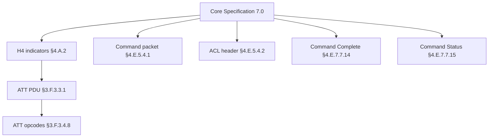

# gattmirror roadmap

`gattmirror` republishes a real Bluetooth LE peripheral inside the Android emulator's virtual Bluetooth
controller, so an app running in the emulator uses its own BLE code against a live adapter. Why this approach
and what was measured: [docs/research.md](docs/research.md). How the crates fit together: [PLAN.md](PLAN.md).

Rows are `Status | Obligation | Anchor | Test`, the grammar `projecthub sync` reads for Rust projects. Each crate
keeps its own rows in `crates/<name>/ROADMAP.md`; this file holds the rows that span them.

Status:

- `[ok]` the named test exists, passes, and failed when the code it covers was deliberately broken. A standard
  named in that row was read.
- `[unread]` implemented and a test passes, but the text that would prove the row was not read, or was read
  and the test does not prove the layout. Advertising-data type identifiers and the Flags bit field are in
  this group: the Core Specification Supplement, Part A, and Assigned Numbers are not imported.
- `[open]` not proven, not done, or needs hardware or a human decision.

## Wave 0: ground truth

| Status | Obligation | Anchor | Test |
|---|---|---|---|
| [open] | Core Specification 7.0 is imported as `bluetooth:core-specification-7-0`. The HCI command, ACL, and event sections and the ATT opcode summary cited in the crate roadmaps were read on 2026-11-21. The Core Specification Supplement, Part A, and Assigned Numbers are not imported, so advertising-data type identifiers and the Flags bit field stay unread | `crates/hci-wire/ROADMAP.md`, `crates/att-server/ROADMAP.md` | none: the supplement is the remaining document gate |
| [ok] | The emulator's H4 socket answers a host that sends Reset first, and answers a command sent before Reset with event `0x10` | observed, `docs/research.md`. §4.E.7.7.16 names event `0x10` Hardware Error; the pre-Reset observation is recorded in `crates/hci-wire/ROADMAP.md` | `crates/hci-wire/tests/live_controller.rs`; see `crates/hci-wire/ROADMAP.md` (needs `GATTMIRROR_HCI`, not run in CI) |

Sections read on 2026-11-21. The supplement and Assigned Numbers are not in this picture, so the Flags bit field and advertising-data type numbers are not nodes.

## Spanning gates (need more than one crate)

| Status | Obligation | Anchor | Test |
|---|---|---|---|
| [open] | **E1.** The emulated phone's BLE scan lists a mirrored device by the real adapter's name | Advertising-data type identifiers and the Flags bit field stay unread. The HCI opcodes for the advertising commands are cited in `crates/hci-wire/ROADMAP.md` | none yet |
| [open] | **E2.** The guest completes GATT service discovery against the virtual peripheral and sees the mirrored table | Bluetooth Core Specification Vol 3 Parts F, G; unread | none yet |
| [open] | **E3.** A guest write to the mirrored write characteristic reaches a simulated adapter and its notification returns to the guest (no hardware) | none: end-to-end, project-defined | none yet |
| [open] | **E4.** The Voltage app in BLE mode selects the mirrored adapter and runs its ELM327 init against the simulated adapter | none: end-to-end | none yet; needs the emulator and the app |
| [open] | **E5.** The same against a real BLE adapter on a bench or in a vehicle | none | none: needs hardware |
| [ok] | The mirror relays attribute traffic only: no OBD, ELM327 or UDS parsing anywhere in the workspace | scope rule, `AGENTS.md` | `crates/gattmirror/tests/relay_only.rs::workspace_rust_relays_attribute_bytes_only`; broken by adding `fn parse_obd_mode` and a spaced response literal in `crates/gattmirror/src/sim.rs` (1 failed) |

## Crates

| Crate | Role | Rows |
|---|---|---|
| `hci-wire` | H4 framing, HCI packets, typed events | [crates/hci-wire/ROADMAP.md](crates/hci-wire/ROADMAP.md) |
| `att-server` | ATT PDUs and the GATT attribute database | [crates/att-server/ROADMAP.md](crates/att-server/ROADMAP.md) |
| `le-host` | LE peripheral host over HCI: advertise, connect, L2CAP | [crates/le-host/ROADMAP.md](crates/le-host/ROADMAP.md) (advertising, connections, ATT channel) |
| `gatt-profile` | text snapshot of a GATT table | [crates/gatt-profile/ROADMAP.md](crates/gatt-profile/ROADMAP.md) |
| `winrt-gatt` | Windows GATT client toward the real adapter | [crates/winrt-gatt/ROADMAP.md](crates/winrt-gatt/ROADMAP.md) |
| `serial-stream` | the `ByteStream` contract (ELM327 byte stream), in-memory and TCP implementations | [crates/serial-stream/ROADMAP.md](crates/serial-stream/ROADMAP.md) |
| `winrt-backend` | the real-adapter `Backend` over `winrt-gatt` (compile-checked only) | [crates/winrt-backend/ROADMAP.md](crates/winrt-backend/ROADMAP.md) |
| `gattmirror` | the relay: `Backend` trait, serial shim, simulated adapter, CLI skeleton | [crates/gattmirror/ROADMAP.md](crates/gattmirror/ROADMAP.md) |

A crate gets a ROADMAP file when work on it starts, not before: an empty table is a promise nobody keeps.

## Not built, and why

- No OBD, ELM327 or UDS logic, and nothing that writes to a vehicle, other than forwarding an app's own
  bytes: this is transport. Scope as in `volt/docs/OBD-CONFIG-SCOPE.md`.
- No gRPC route (`registerGattDevice`) until the HCI route has been shown to fail: it would make this
  portfolio write HTTP/2, HPACK, protobuf and gRPC first. Recorded in `docs/research.md`.
- No Bluetooth classic (SPP). The Voltage app's *Bluetooth* mode is classic; only BLE is mirrored.
